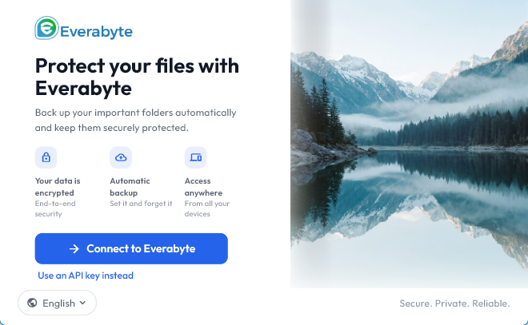

# EverBox Desktop

The official Everabyte backup application for Windows, macOS and Linux.



EverBox protects your computer folders by running the backup jobs configured
in your Everabyte account. Files are processed through Everabyte's encrypted
storage pipeline, while incremental backups avoid transferring unchanged
files again.

EverBox is part of the [Everabyte](https://everabyte.com) ecosystem, a cloud
storage platform designed for individuals, teams and businesses.

## Features

- scheduled backups and manual job execution;
- incremental backups based on file content;
- recovery after network interruptions and a persistent upload queue;
- single-process operation, with no separate system service or daemon;
- background operation from the Windows/Linux system tray or macOS menu bar;
- credentials stored in the operating system's native secure store:
  Credential Manager, Keychain or Secret Service;
- execution history, activity logs and sanitized diagnostics;
- support for Windows 10/11, macOS and Linux.

## Requirements

1. An active Everabyte account.
2. An Everabyte API key pair authorized to read buckets, folders and files,
   and to write to the backup scope.
3. A computer compatible with the target operating system.

The **Full Access** preset is recommended for the initial setup. A key limited
to file access cannot create or browse subfolders; in that case, the backup
must target the root of a bucket.

## Downloads — one release, every platform

Every version is published as **one GitHub release** carrying the Windows,
macOS and Linux packages together, plus a `SHA256SUMS.txt` covering them
all. Assets keep **stable, version-independent names**, so the permanent
"latest" links below always serve the newest published build — these are
the links used on [everabyte.com](https://everabyte.com):

| Package | Permanent download link (always the latest release) |
| --- | --- |
| All packages | <https://github.com/everabyte/everbox-realease/releases/latest> |
| Windows (x64) | <https://github.com/everabyte/everbox-realease/releases/latest/download/EverBox-Setup-x64.exe> |
| macOS (Apple Silicon) | <https://github.com/everabyte/everbox-realease/releases/latest/download/EverBox-macOS-arm64.dmg> |
| macOS (Intel) | <https://github.com/everabyte/everbox-realease/releases/latest/download/EverBox-macOS-x64.dmg> |
| Linux (amd64, .deb) | <https://github.com/everabyte/everbox-realease/releases/latest/download/EverBox-Linux-amd64.deb> |
| Linux (amd64, AppImage) | <https://github.com/everabyte/everbox-realease/releases/latest/download/EverBox-Linux-amd64.AppImage> |
| Linux (arm64, .deb) | <https://github.com/everabyte/everbox-realease/releases/latest/download/EverBox-Linux-arm64.deb> |
| Checksums | <https://github.com/everabyte/everbox-realease/releases/latest/download/SHA256SUMS.txt> |

A platform that has no build yet simply has no asset under that name until
its first build; adding a platform to an **existing** release is supported
(see "Publishing a release" below). Verify downloads against
`SHA256SUMS.txt`.

## Installation and first backup

1. Download the package for your operating system from
   [releases/latest](https://github.com/everabyte/everbox-realease/releases/latest)
   or from the Everabyte download page.
2. Verify the signature and checksum published with the package before
   installing it.
3. Launch EverBox and enter the Everabyte endpoint and your API key pair. The
   key is validated before it is stored.
4. Select an authorized bucket and target path.
5. Map local folders to the jobs configured in your Everabyte account, then
   let EverBox follow the schedule.

Closing the window hides the application in the system tray or menu bar; it
does not stop a backup in progress. Use **Quit EverBox** to stop the
application completely. Queue state is preserved so that work can resume at
the next launch.

## Security model

EverBox communicates only with Everabyte. Credentials for third-party storage
providers — such as S3, Wasabi, iDrive or Backblaze — are not used by the
application.

Secrets are stored in the operating system's secure store and are never
written in plain text to a configuration file or displayed in logs. Network
connections use HTTPS. Paths, errors and diagnostic data are validated or
sanitized before they are sent or exported.

Everabyte documents a zero-knowledge storage architecture: encryption keys
are not held by Everabyte, and the platform cannot read the content of
encrypted files. See the [Terms and
Conditions](https://everabyte.com/en/terms-and-conditions) and the [security
documentation](https://everabyte.com/en/help/privacy-compliance) for the
service commitments and applicable limitations.

## Published version

This release corresponds to **EverBox Desktop 1.1.2 (build 13)**. Release
notes and fixes are published with each distributed package — see
[releases](https://github.com/everabyte/everbox-realease/releases) and the
changelog feed ([`CHANGELOG.json`](./CHANGELOG.json)).

Stable asset names per platform (identical in every release):

| Operating system | Asset name |
| --- | --- |
| Windows (x64) | `EverBox-Setup-x64.exe` |
| macOS (Apple Silicon / Intel) | `EverBox-macOS-arm64.dmg` / `EverBox-macOS-x64.dmg` |
| Linux (amd64 / arm64) | `EverBox-Linux-amd64.deb`, `EverBox-Linux-amd64.AppImage`, `EverBox-Linux-arm64.deb` |

## Build and release

Each version is one GitHub release named `<version>+<build>` (for example
`1.2.0+16`). The scripts in [`scripts`](./scripts) create the release assets
and mark the resulting GitHub release as **Latest**. The permanent download
links above therefore always resolve to the newest published build.

The installers must first be available in this repository, under their
versioned platform directory, and `CHANGELOG.json` must contain the same
version and build number:

```text
windows/x64/stable/<version>/
macos/arm64/stable/<version>/
macos/x64/stable/<version>/
linux/amd64/stable/<version>/
linux/arm64/stable/<version>/
```

Publish a build as follows:

```bash
# 1. Commit and push the versioned packages and CHANGELOG.json.
git add -A
git commit -m "release 1.2.0+16"
git push origin main

# 2. Validate the files, create the annotated tag, push it, and trigger
#    the GitHub release workflow.  The workflow generates SHA256SUMS.txt,
#    release notes and the stable-named assets, then marks the release latest.
bash scripts/tag-release.sh 1.2.0+16 --push
```

`tag-release.sh` refuses an invalid tag, a dirty repository, a missing
package, or a tag/version/build that does not match `CHANGELOG.json`. It
calls `build-release-assets.sh` before creating the tag, so a tag is never
created for an incomplete release.

The workflow [`.github/workflows/github-release.yml`](.github/workflows/github-release.yml)
runs when the tag is pushed. It uses these scripts:

| Script | Purpose |
| --- | --- |
| `scripts/tag-release.sh` | Validates a release and creates the annotated tag; `--push` starts the automated workflow. |
| `scripts/build-release-assets.sh` | Collects the versioned installers, gives them stable asset names, and generates `SHA256SUMS.txt` and release notes. |
| `scripts/create-release.sh` | Creates or updates the GitHub release and marks it Latest; it is used by the workflow and can also be run locally with the GitHub CLI. |

If a platform is built after the initial publication, commit its package and
re-run the `github-release` workflow for the existing tag. The script is
idempotent: it refreshes that release's matching assets without creating a
second release.

Platform directories intentionally contain only versioned package files.
There is no per-platform `README.md` or `latest.json`; GitHub Releases is
the single source for the current/latest downloadable build.

## Support

- Website: [everabyte.com](https://everabyte.com)
- Help Center: [everabyte.com/en/help](https://everabyte.com/en/help)
- Support: [support@everabyte.com](mailto:support@everabyte.com)
- Key, permission or bucket issues: first check the key scopes and the bucket
  scope configured in Everabyte.

## Copyright

See [`COPYRIGHT.md`](COPYRIGHT.md) for the copyright notice, trademarks and
general distribution terms for the application.

